 

 

### Hello — I'm Samir.

I build web products for the Egyptian market, end to end: the interface, the backend, the AI layer, and the delivery. Most of what I ship is **Arabic-first and RTL-native**, because that is who the users are.

My recent work spans a PropTech platform, a university activity portal with Arabic OCR and PDF generation, and AI-assisted tools built on the Gemini API. I care about products that are clear to use, honest about what they do, and maintainable after launch.

 

### Selected Work

| Project | What it is | Built with |
|:--|:--|:--|
| [**Aqar-Go — عقار جو**](https://github.com/x-samir-official-x/Aqar-Go) | AI-powered PropTech platform connecting buyers, sellers and financing banks in Egypt | React · TypeScript · Vite · Express · Gemini API · Recharts |
| [**أَثَر — Student Activity Portal**](https://github.com/x-samir-official-x/SCU_Website) | Faculty of Commerce (SCU) portal: activity submission, staff review, Arabic PDF forms and grading — demo build | React · TypeScript · Express · Tesseract OCR (Arabic/English) · Zod · Helmet |
| [**Safe Space**](https://github.com/x-samir-official-x/safe-space-egypt) | Mental-wellbeing platform for young adults in Egypt with mood tracking and a supportive AI companion | React · TypeScript · Gemini API · Recharts · Tailwind |
| [**Environment Friends — أصدقاء البيئة**](https://github.com/x-samir-official-x/env_friends_scu) | Official site of the faculty's environment team, content-driven from a single config file | HTML · CSS · JavaScript · GitHub Pages |

Client and internal work, not public: **Kadry OS** (operations dashboard), **Banker's Lounge** (banking education platform), and a **WhatsApp lead follow-up bot** for an academy.

 

### Toolkit

| Area | Technologies I use in my repositories |
|:--|:--|
| **Languages** | TypeScript · JavaScript · HTML · CSS |
| **Frontend** | React · Vite · Tailwind CSS · Radix UI / shadcn · TanStack Query · Framer Motion · Recharts |
| **Backend & Data** | Node.js · Express · Supabase · Zod · Nodemailer · Helmet · Rate limiting |
| **AI & Documents** | Gemini API · Tesseract OCR (Arabic + English) · Arabic PDF generation |
| **Ship** | Vercel · Cloudflare · GitHub Pages · Git |

 

### Contribution Activity

  

### GitHub Stats

  

