<a href="https://github.com/x-samir-official-x">
  
</a>

  
  
  



<a href="https://github.com/x-samir-official-x/Aqar-Go"></a>

  

<a href="https://github.com/x-samir-official-x/SCU_Website"></a>

  

<a href="https://github.com/x-samir-official-x/safe-space-egypt"></a>

  

<a href="https://github.com/x-samir-official-x/env_friends_scu"></a>

  



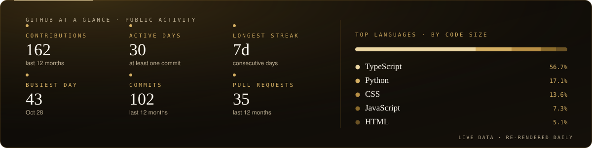



  
  
  

<a href="https://github.com/x-samir-official-x">
  
</a>
